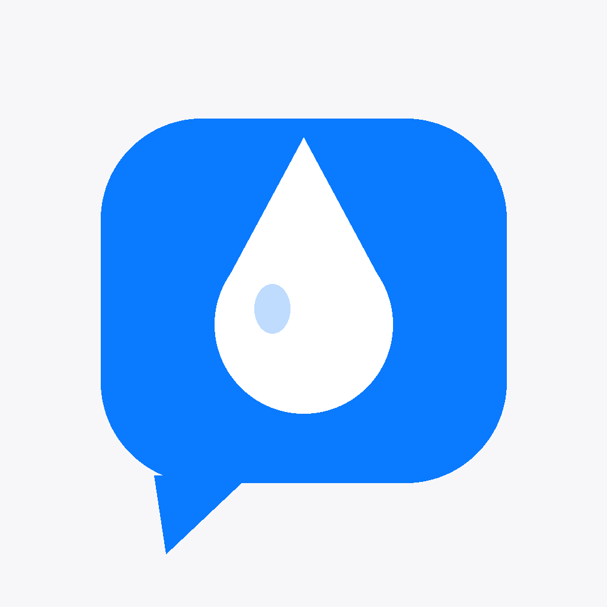
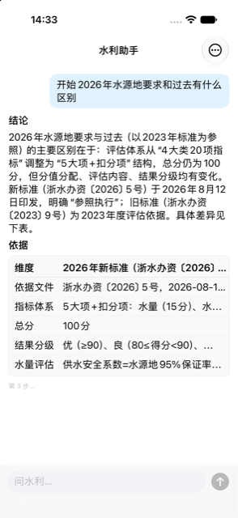
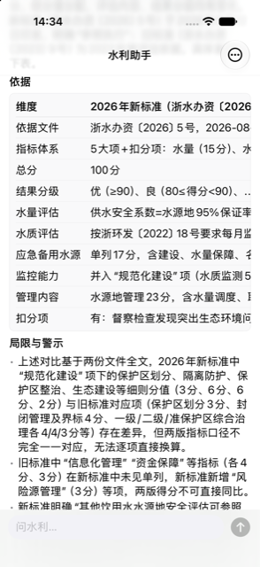
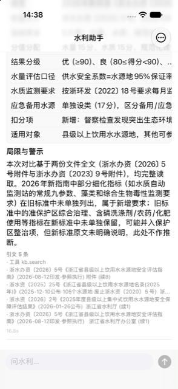

**中文** | [English](README_EN.md)

<p align="center"></p>

# Water Assistant · 水利助手

**水利问题问一句，十几秒拿到带引文的答案。**

    

自建领域 agent 的手机端：流式打字机、步骤与工具进度实时可见、答案带引文，七种终态如实显示——包括「有保留」和「拒答」。业务零本地逻辑，后端加能力不用动 app。

<table><tr>
<td align="center" width="25%"><br><sub>问一句「2026 年水源地要求和过去有什么区别」——结论先行，依据表随后</sub></td>
<td align="center" width="25%"><br><sub>答案自带「局限与警示」：两版指标口径不能逐项换算这种话，它主动说</sub></td>
<td align="center" width="25%"><br><sub>线上真对话：新旧标准对比 + 局限警示 + 引文 5 条，16.8 秒</sub></td>
</tr></table>

## 它做什么

| 功能 | 说明 |
|---|---|
| **SSE 流式，步骤看得见** | 答案打字机式流出，检索/比对的步骤进度实时可见——十几秒的等待里你知道它在干什么，不是对着转圈猜。 |
| **答案带引文，也带局限** | 每个结论下面是依据表和引文清单；口径对不上、无法逐项换算这类局限，它写在答案里而不是等你踩坑。七种终态如实显示——包括「有保留」和「拒答」。 |
| **业务零本地逻辑** | 所有智能在后端 agent，app 是薄壳。后端加一种能力、改一版提示词，手机端一行不用动——这正是薄壳的全部意义。 |

## 怎么拿到

TestFlight 内测中（2026-09-02 首发）；后端私有，不开放试用。

薄壳，全部智能在私有后端 `hydro-agent.tianli.cyou`（访问闸后）。代码可读可编，没有后端账号跑不出对话。

## 构建

```bash
brew install xcodegen
xcodegen generate
xcodebuild -scheme HydroDeck -destination 'generic/platform=iOS Simulator' build
```

- 仓里的 `*.sh` 是作者本机舰队脚本的 shim（三平台构建 / 真机装机 / TestFlight），依赖 `~/Dev` 下的总部工具，不在本仓；没有那套工具时它们会明确退出。
- `Shared/PlatformCompat.swift` 是总部共享文件的逐字节副本（iOS-only SwiftUI 修饰符在 macOS 侧的同名 no-op），别在这里改它。

开发细节（回归、验证通道、约束）见 [DEVELOPING.md](DEVELOPING.md)。

## Apple 平台

同一份对话模型和会话存储用于 iPhone、iPad、Mac 与原生 Vision Pro。iPhone 保留打开即聊的窄屏；iPad 宽屏、Mac 与 Vision Pro 常驻会话侧栏，长答案限宽阅读。Mac 版由本工程的原生 macOS target 构建。

| 平台 | 当前源码 | 本轮运行与资源验收 |
|---|---|---|
| iPhone / iPad | iOS 18+，原生目标 | 待模拟器验收 |
| Mac | macOS 15+，原生目标 | 待静默运行验收 |
| Vision Pro | visionOS 26+，原生目标 | 待模拟器验收，尚未发行 |
| Apple Watch | 不适用 | 长答案、表格、引文和现场图片不适合手表屏幕；暂无独立的手表任务 |

平台验收用 `-lane_demo YES` 载入三条明确标注虚构的会话，存储在临时目录，网络请求在进程内被拦截，不读取闸密码或写入正式会话。该入口用于界面与资源验收，不代表已连接真实后端。

下方资源区块来自此前 0.1 (2) 的发行与 iPhone 模拟器记录；本轮新增平台的资源待测，旧数字不作为四平台实测。

## 相关

- 产品页：<https://apps.tianli.cyou/p/hydro-deck-ios.html>
- 舰队总览（10 个 app 怎么来的）：<https://apps.tianli.cyou/ios.html>
- 教程：[从零到 TestFlight：一个人做 iPhone app 的完整路径](https://blog-ai.tianli.cyou/nine-ios-apps-in-two-weeks)

## License

MIT © 2026 曾田力 (Tianli Zeng)

<!-- lightweight:start -->
## 资源占用

安装包为 App Store 数据；内存、CPU 与启动时间为 iOS 模拟器实测，不是真机数值。

| 安装包 | 空闲内存 | 空闲 CPU | 模拟器冷启动到首屏就绪 |
|---|---|---|---|
| **0.3 MB**（装好后 0.9 MB） | **28.3 MB** | **0.02%** | **4.3 s** |

体积按具体发行构建回读；真机尚未测量，内存、CPU 与启动时间先用 iOS 模拟器实测并标明环境。

<sub>v0.1 (2) · iPhone 17（iPhone18,3）；体积为 Apple 设备切片记录，运行性能尚未真机实测 · TestFlight VALID（未上架，仅内测组）；体积不含用户数据与后续缓存；手机实际安装版本尚未核验 · 2026-09-29。体积来自 Apple App Store Connect 对应构建的设备切片记录。内存、CPU 与启动时间是 iPhone 17 Pro / iOS 27.0 Simulator / Mac16,12 / Apple M4 / macOS 27.2 上本地源码 Release 构建 v0.1 (2) 的实测（2026-09-29），只统计 App 进程，不等于真机数值；真机测量尚未完成。内存口径为 phys_footprint；CPU 为 60 秒采样窗内 CPU 时间 ÷ 墙钟；大小按十进制 MB。原始数据见 [perf/lightweight.json](perf/lightweight.json)。</sub>
<!-- lightweight:end -->


## 配置与 App 更新

新构建在主界面下方提供「配置与更新」，显示当前安装包的真实版本和构建号。

当前没有独立可迁移的偏好配置，界面不提供空的 iCloud 开关。账号、访问凭据、业务内容、本机权限与缓存继续使用各自原有入口。

「在 TestFlight 中检查更新」打开系统 TestFlight；内测新包由 TestFlight 安装。 此入口检查 App 版本，资料或后台数据刷新仍在原入口。

Mac 沙盒版通过本人 iCloud Drive 中的私有发行包检查更新。首次在「选择 iCloud Drive 更新目录」中选择系统 iCloud Drive 根目录；此目录授权只保存在本机。只有实际发布的发行记录才会出现安装包入口；打开校验后的 ZIP，将其中的 App 放入应用程序文件夹完成升级。

版本号更新属于本轮新构建；手机上的新版本需通过签名安装或原商店/TestFlight 渠道取得，发行状态以现有发布记录为准。

Mac 版没有可迁移偏好，不显示配置同步开关；目录书签只保存本机更新目录授权。
